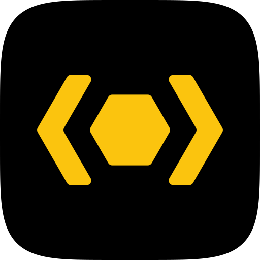

  

An open-source company building best-in-class tooling for humans and agents

 

<h3>Projects / Products</h3>

<table>
  <tr>
    <td align="center"></td>
    <td><a href="https://zod.dev"><b>Zod</b></a></td>
    <td>TypeScript-first schema validation with static type inference. owned&nbsp;by&nbsp;<a href="https://github.com/colinhacks">@colinhacks</a></td>
    <td></td>
  </tr>
  <tr>
    <td align="center"><picture><source media="(prefers-color-scheme: dark)" srcset="logos/hey-api-dark.svg"></picture></td>
    <td><a href="https://heyapi.dev"><b>Hey&nbsp;API</b></a></td>
    <td>Turn API specifications into production-ready SDKs, validators, mocks, and more. owned&nbsp;by&nbsp;<a href="https://github.com/mrlubos">@mrlubos</a></td>
    <td></td>
  </tr>
  <tr>
    <td align="center"><picture><source media="(prefers-color-scheme: dark)" srcset="logos/nub-dark.svg"></picture></td>
    <td><a href="https://nubjs.com"><b>Nub</b></a></td>
    <td>The all-in-one toolkit for Node.js.</td>
    <td></td>
  </tr>
  <tr>
    <td align="center"></td>
    <td><a href="https://playwriter.dev"><b>Playwriter</b></a></td>
    <td>Control your real Chrome with Playwright from an agent, a CLI, or an MCP server. owned&nbsp;by&nbsp;<a href="https://github.com/remorses">@remorses</a></td>
    <td></td>
  </tr>
  <tr>
    <td align="center"><picture><source media="(prefers-color-scheme: dark)" srcset="logos/gpuix-dark.png"></picture></td>
    <td><a href="https://gpuix.dev"><b>GPUIX</b></a></td>
    <td>Build native apps with React or Solid on Zed's GPUI, from Node.js or Bun. owned&nbsp;by&nbsp;<a href="https://github.com/remorses">@remorses</a></td>
    <td></td>
  </tr>
  <tr>
    <td align="center"></td>
    <td><a href="https://reylo.dev"><b>Reylo</b></a></td>
    <td>Import .sql files into TypeScript, typed from your live database.</td>
    <td></td>
  </tr>
  <tr>
    <td align="center"><picture><source media="(prefers-color-scheme: dark)" srcset="logos/pullfrog-dark.png"></picture></td>
    <td><a href="https://pullfrog.com"><b>Pullfrog</b></a></td>
    <td>The batteries-included agent workflow platform for GitHub. commercial</td>
    <td></td>
  </tr>
  <tr>
    <td align="center"><picture><source media="(prefers-color-scheme: dark)" srcset="logos/holocron-dark.png"></picture></td>
    <td><a href="https://holocron.so"><b>Holocron</b></a></td>
    <td>A drop-in replacement for Mintlify, as a Vite plugin. owned&nbsp;by&nbsp;<a href="https://github.com/remorses">@remorses</a></td>
    <td></td>
  </tr>
</table>

<h3>Team</h3>

<table>
  <tr>
    <td></td>
    <td><b>Colin McDonnell</b> <a href="https://github.com/colinhacks">@colinhacks</a></td>
    <td>Works on Zod, Nub, Reylo, and Pullfrog.</td>
    <td><a href="https://colinhacks.com">colinhacks.com</a> · <a href="https://x.com/colinhacks">X</a> · <a href="https://bsky.app/profile/colinhacks.com">Bluesky</a></td>
  </tr>
  <tr>
    <td></td>
    <td><b>Lubos</b> <a href="https://github.com/mrlubos">@mrlubos</a></td>
    <td>Works on Hey API.</td>
    <td><a href="https://lubo.sh">lubo.sh</a> · <a href="https://x.com/mrlubos">X</a> · <a href="https://bsky.app/profile/lubo.sh">Bluesky</a></td>
  </tr>
  <tr>
    <td></td>
    <td><b>Tommy D. Rossi</b> <a href="https://github.com/remorses">@remorses</a></td>
    <td>Works on Playwriter, GPUIX, and Holocron.</td>
    <td><a href="https://x.com/__morse">X</a> · <a href="https://bsky.app/profile/xmorse.bsky.social">Bluesky</a></td>
  </tr>
</table>

Variadic employs people to work full time on open source while allowing them to maintain total editorial control over their own projects.

